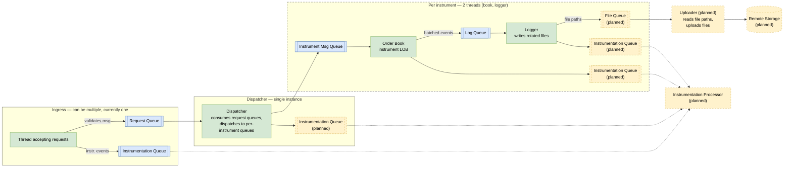

# LOB

**LOB** is a low-latency limit order book written in C++20.

- Matches limit orders by price-time priority, with partial fills
- Supports add, modify and delete orders
- Receives orders over UDP and routes them to one order book per instrument, each on its own thread
- Publishes every outcome (add, fill, modify, delete, reject) to an asynchronous logger
- Threads communicate through an in-house lock-free SPSC queue
- Validates tick size, price band and duplicate order IDs

## Architecture



Legend: green = component, blue = queue, dashed yellow = planned.

Each instrument's book is owned by a single thread and fed by an SPSC queue, so the matching path takes no locks.

## Benchmark results

Apple M1 Pro (6P + 2E cores), 16 GB, macOS 26.4.1 · Apple clang 21.0.0, Release build · Google Benchmark 1.9.1.
Latencies come from the CPU's 24 MHz counter, so they are multiples of one tick (41.7 ns). Raw output is in [`results/`](results/).

### NSpsc queue

#### Throughput

One producer and one consumer thread, 1M messages, median of 15 runs. Single: one message per push/pop. Batch: 1,000 messages per push/pop.

| Message | Mode | 32K-slot queue | 1M-slot queue |
|---|---|---|---|
| 8 B | single | 51.6 M msg/s | 18.2 M msg/s |
| 8 B | batch | 506 M msg/s | 232 M msg/s |
| 128 B | single | 45.5 M msg/s | 77.2 M msg/s |
| 128 B | batch | 285 M msg/s | 231 M msg/s |

#### Latency

Push to pop, sent at a fixed rate, 1M messages, median of 15 runs.

8 B messages, 32K-slot queue:

| Rate | p50 | p90 | p99 | p99.9 |
|---|---|---|---|---|
| 250k msg/s | 42 ns | 83–250 ns | 542 ns | 12.1 µs |
| 500k msg/s | 42 ns | 42–83 ns | 458 ns | 11.0 µs |
| 1M msg/s | 42 ns | 42–250 ns | 458 ns | 10.8 µs |
| 2M msg/s | 42 ns | 42–250 ns | 458 ns | 13.9 µs |

128 B messages, 1M-slot queue:

| Rate | p50 | p90 | p99 | p99.9 |
|---|---|---|---|---|
| 250k msg/s | 42 ns | 83–167 ns | 375 ns | 10.0 µs |
| 500k msg/s | 42 ns | 42–167 ns | 333 ns | 10.3 µs |
| 1M msg/s | 42 ns | 42 ns | 333 ns | 8.8 µs |
| 2M msg/s | 42 ns | 42–167 ns | 333 ns | 9.8 µs |

p90 sits on the boundary between one and a few ticks, so it moves between runs; the range covers every run (three for 8 B, two for 128 B).

### Order book

#### Closed loop

The book alone, one message at a time on a single thread (no queues).

Cost per operation (mean):

| Operation | ns |
|---|---|
| Add (existing level / new level) | 27 / 28 |
| Delete (level stays / level emptied) | 26 / 27 |
| Modify (quantity down / quantity up / price) | 44 / 50 / 50 |
| Crossing add, per level swept (1 → 16 levels) | 52 → 46 |

Throughput on a mix of adds, deletes and modifies (1M messages, median of 5 runs):

| Load | msg/s | ns/msg |
|---|---|---|
| Resting (no crossing) | 21.7 M | 46 |
| Aggressive (10% of adds set to cross, up to 3 levels) | 21.1 M | 47 |

Latency per operation on the same mixes:

| Operation | p50 | p99 | p99.9 |
|---|---|---|---|
| Add | 42 ns | 83 ns | 83 ns |
| Delete | 42 ns | 83 ns | 125–167 ns |
| Modify | 83 ns | 125–167 ns | 125–167 ns |
| Crossing add, 1 / 2 / 3+ levels | 42 / 83 / 125 ns | 83 / 167 / 250 ns | 125 / 208 / 333 ns |

#### End to end

Producer thread → message queue → book thread → log queue → consumer thread. Open loop: each message is sent at its scheduled time whether or not the book has caught up, and latency runs from that scheduled time until the message's last log event is popped. 1M messages per rate.

Resting load (no crossing):

| Rate | p50 | p90 | p99 | p99.9 |
|---|---|---|---|---|
| 100k msg/s | 0.21 µs | 0.79 µs | 1.29 µs | 27.2 µs |
| 500k msg/s | 0.21 µs | 0.63 µs | 1.17 µs | 27.9 µs |
| 1M msg/s | 0.17 µs | 0.63 µs | 0.92 µs | 24.4 µs |
| 2M msg/s | 0.17 µs | 0.54 µs | 0.67 µs | 28.7 µs |

Aggressive load (10% of adds set to cross, up to 3 levels):

| Rate | p50 | p90 | p99 | p99.9 |
|---|---|---|---|---|
| 100k msg/s | 0.21 µs | 0.96 µs | 1.29 µs | 25.3 µs |
| 500k msg/s | 0.21 µs | 0.63 µs | 1.13 µs | 23.5 µs |
| 1M msg/s | 0.21 µs | 0.58 µs | 0.71 µs | 24.2 µs |
| 2M msg/s | 0.21 µs | 0.58 µs | 0.79 µs | 22.6 µs |
| 5M msg/s | 0.17 µs | 0.33 µs | 0.79 µs | 26.7 µs |

p99.9 stays near 25 µs at every rate and on both loads, which points to the operating system (interrupts, scheduling) rather than the book.

## Build & run

Prerequisites: macOS or Linux, CMake 3.25+, and Clang 17+ or GCC 13+.

```sh
git clone https://github.com/skarthik21/lob.git && cd lob
cmake -S . -B build
cmake --build build -j
```

Run the app (listens for orders on UDP port 8099, writes event logs to `/tmp/lob/book/`, Ctrl-C to stop):

```sh
./build/lob
```

Run the tests:

```sh
ctest --test-dir build
```

Run the benchmarks:

```sh
./build/NSpscBenchmark
./build/NSpscLatencyBenchmark
./build/OrderBookBenchmark
./build/OrderBookE2EBenchmark
```

## Directory structure

```
lob/
├── src/                   source code
│   ├── entities/
│   ├── logger/
│   ├── orderBook/
│   ├── queue/
│   │   ├── nspsc/
│   │   └── spsc/
│   ├── requestProcessor/
│   │   ├── controller/
│   │   └── dispatcher/
│   ├── utils/
│   └── Main.cpp
├── tests/                 unit tests
│   ├── orderBook/
│   └── queue/
│       ├── nspsc/
│       └── spsc/
├── benchmarks/            benchmarks
│   ├── orderBook/
│   └── queue/
│       ├── nspsc/
│       └── spsc/
├── results/               benchmark results (JSON)
├── CMakeLists.txt
└── LICENSE
```
